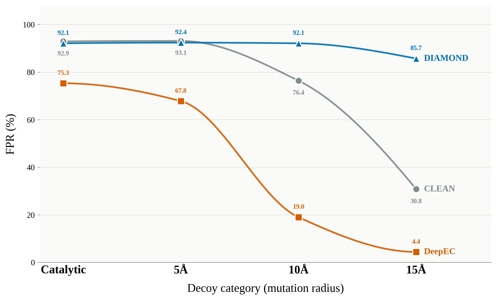
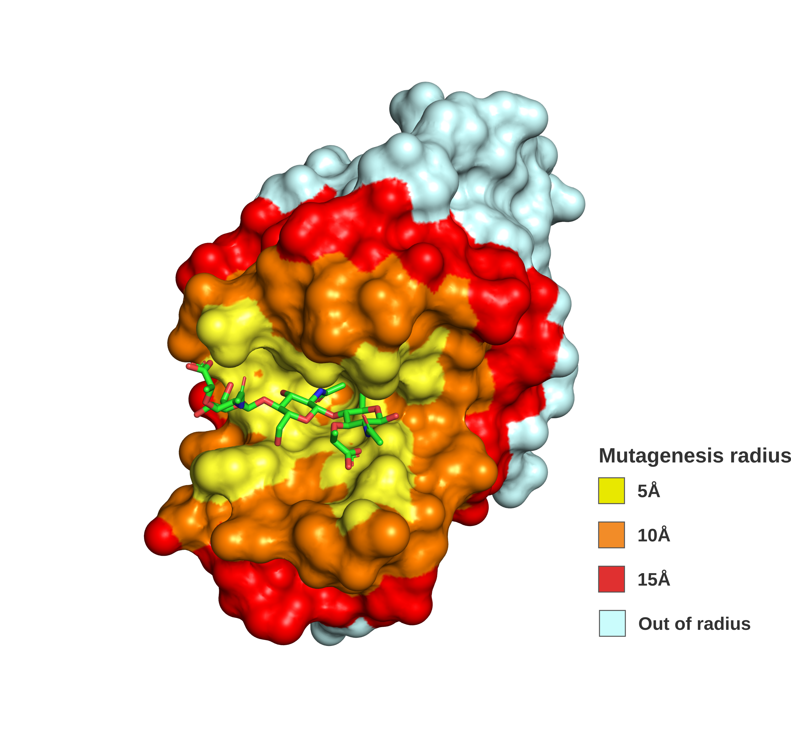

# EnzymARC

**EnzymARC** is a benchmark dataset of non-functional **decoy enzyme sequences**, built to test whether state-of-the-art Enzyme Commission (EC) number predictors actually learn the structural determinants of catalysis — or whether they simply exploit global sequence similarity to annotated homologues.

## Overview

Modern EC number predictors (homology-based tools, deep learning models, and contrastive-learning / protein language model approaches) are trained almost exclusively on functional, annotated enzymes. This raises a fundamental question: do these models recognize the actual catalytic machinery of a protein, or are they just pattern-matching against known enzyme families regardless of whether that machinery is intact?

To probe this, we built **EnzymARC** (inspired by the ARC challenge for testing out-of-distribution generalization) — a set of decoy sequences derived from real, experimentally annotated enzymes by systematically disrupting their active sites through structure-guided mutagenesis. Each decoy retains most of the sequence context and scaffold of its parent enzyme, but its catalytic residues (and, in some categories, the surrounding structural neighborhood) have been mutated in a way expected to abolish enzymatic function.

We benchmarked three representative EC prediction paradigms against this dataset:

- **DIAMOND** — homology-based annotation transfer
- **CLEAN** — contrastive learning over protein language model (ESM-1b) embeddings
- **DeepEC** — a deep learning model explicitly trained to discriminate enzymes from non-enzymes

Across all three, we found high false positive rates at low levels of perturbation — models frequently assigned the original EC number to sequences whose catalytic residues had been destroyed — revealing a strong reliance on phylogenetic/sequence-similarity shortcuts rather than genuine recognition of catalytic competence. Models explicitly exposed to negative (non-enzyme) examples during training (DeepEC) showed better — though still incomplete — sensitivity to these disruptions.

This repository provides the decoy sequence datasets used in the benchmark, so they can be reused to evaluate other EC predictors or to train more structurally aware models.



*False positive rate (FPR) as a function of decoy category (mutation radius) for the three benchmarked EC predictors. DIAMOND (blue) and CLEAN (gray) remain highly vulnerable across most perturbation levels, only degrading meaningfully at the 15 Å decoys. DeepEC (orange), which was explicitly trained on non-enzyme discrimination, shows much stronger sensitivity to active-site disruption, dropping to an FPR of 4.4% at 15 Å.*

## Dataset

The dataset was derived from Swiss-Prot (UniProtKB, manually reviewed entries, retrieved March 10, 2026), filtered to sequences with a complete EC number, a Rhea ID, and a length between 100–1,000 amino acids (218,504 sequences). Of these, 79,505 entries had experimentally annotated active site residues and were used as the basis for decoy generation.

Two decoy generation strategies, producing **four decoy categories**, are provided as FASTA files:

| File | Category | Strategy | # Sequences | Median identity to parent | Median mutated residues |
|---|---|---|---|---|---|
| `decoys_catalytic.fasta` | Catalytic | Each annotated active-site residue masked and replaced with one of the 5 lowest-probability amino acids predicted by ESM-2 (`esm2_t33_650M_UR50D`) | 79,505 | 99.6% | 1 |
| `decoys_5A.fasta` | 5 Å shell | Structure-aware random mutagenesis of residues within 5 Å of the active-site center of mass (structures from AFDB/PDB) | 73,077 | 98.4% | 5 |
| `decoys_10A.fasta` | 10 Å shell | Same as above, radius extended to 10 Å | 73,077 | 89.8% | 35 |
| `decoys_15A.fasta` | 15 Å shell | Same as above, radius extended to 15 Å | 73,077 | 72.9% | 94 |



*Structural representation of the progressive active-site mutagenesis strategy. Concentric shells were expanded to include residues within 5 Å (yellow), 10 Å (orange), and 15 Å (red) of the catalytic site center of mass. Residues within each shell were substituted to generate progressively more disruptive non-functional enzyme decoys, while preserving the overall protein scaffold and a realistic degree of sequence similarity to the parent enzyme.*

**Notes:**
- The **Catalytic** category represents the most subtle, targeted disruption (often a single residue change) and is the most challenging negative control.
- The **5/10/15 Å** categories form a progressive series of increasingly disruptive, structure-guided mutagenesis, all centered on the annotated active site but expanding outward through concentric spherical shells.
- Each decoy sequence retains the UniProt accession of its parent (source) sequence, allowing self-hits to be identified and filtered out when benchmarking homology-based tools.
- The 5/10/15 Å categories require a resolved or predicted 3D structure (from PDB or AlphaFold DB) for the parent sequence; entries without structural coverage were excluded from those categories.

### FASTA header format

```
>{uniprot_accession}|{decoy_category}|EC:{original_ec_number}
SEQUENCE...
```

## Repository Contents

```
EnzymARC/
├── data/
│   ├── decoys_catalytic.fasta
│   ├── decoys_5A.fasta
│   ├── decoys_10A.fasta
│   └── decoys_15A.fasta
├── README.md
└── ...
```

## Citation

If you use EnzymARC in your work, please cite:

> Sartori, J., Guimarães, A.C.R., Machado, L.A. *A novel benchmark dataset for enzyme function prediction reveals the limitations of state-of-the-art models.* (2026).

## License

